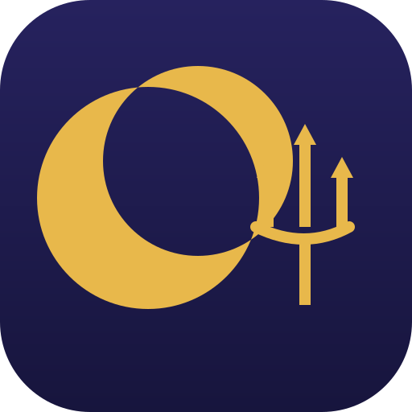

<div align="center">



# Bholeynath

**A desktop companion for your Windows laptop — and, from the same codebase, for Mac, iPhone and Android — that keeps an eye on your AI coding agent sessions.**

Narayan, your assistant, lives at the top of your screen. Approve permissions, watch your agents work, drop a file, chat with Claude — all without leaving what you're doing.


ॐ नमः शिवाय

</div>

---

## Bholeynath on Windows

Narayan lives in a small island at the top-centre of your screen. It stays out of the way until something needs you.

- 🤖 **Claude Code, Cursor, Codex, Gemini CLI, Antigravity, Copilot CLI, Muse Code, OpenCode, Amp, Hermes, Claude Desktop and other agents, live** — see every session: what it reads, edits and runs, step by step. Tag a hook payload with `bholeynath_agent` to give any agent its own pill.
- ✅ **Approve and answer from the island** — permission requests show up with **Allow / Deny / Always**; `AskUserQuestion` prompts show the choices right in the island (single or multi-select, up to 4 questions). One click, or "Reply in terminal" to fall back to the CLI. Codex also gets Allow / Deny.
- 🧑‍💻 **Jump to the right terminal** — bring the session's window forward.
- 💬 **Chat with Claude, Gemini, OpenAI, DeepSeek, Qwen, Moonshot, or a local model (Ollama / LM Studio)** — cloud providers use your own API key; local providers connect to a server on your machine. **No API key? Use your subscription**: the chat goes through the official terminal tool you already pay for — Claude Code, Antigravity CLI, Gemini CLI, Codex CLI, Cursor CLI or GitHub Copilot CLI.
- 📎 **Drop a file on the island** — Narayan swallows it, then answers questions about it.
- 🔌 **Integrations** — Stripe payments, n8n workflows, GitHub (open PRs, reviews requested, CI status), Vercel deployments, Resend emails, Notion, Cal.com. Each one gets its own little pill.
- ✉️ **Mail** — classic Outlook on Windows: search every inbox, read a message and act on it (reply, mark as read, important, junk). Nothing is ever deleted.
- 🖥️ **Narayan on the desktop** — drag Narayan out of the island and he floats on your desktop, follows your cursor, and comes back where you left him on next launch.
- ⌨️ **Keyboard shortcuts** — open the chat (`Ctrl+Alt+Space`), jump to a waiting permission (`Ctrl+Alt+A`), bring the session's window forward (`Ctrl+Alt+T`), switch pills, mute, open the wardrobe, send Narayan to the desktop — all customizable in Settings → Shortcuts.
- 🎭 **A real character** — Narayan is drawn in code: idle breathing, blinks, eyes that follow your mouse, emotes, 29 synthesized sounds, a greeting on launch. Dress him up from the wardrobe; he also dresses for the seasons on his own.
- 🗣️ **"OK Bholeynath"** — talk to Narayan like Jarvis (voice features are Mac-only in the carried-over code; see below).
- 📅 **Weekly recap** — every Monday morning, a summary of the past week: time coding, sessions, files, lines changed, commands, permissions, top agent and project, busiest day and longest session. Share it as an image, project names optional. All local, no sync.
- 🌍 **Languages** — the carried-over interface ships 16 languages on Mac and 14 on Windows/Linux. Nepali localization is planned as a separate phase and is not in this build.

## Hindu theme

Bholeynath wears a complete Hindu theme: a manuscript aesthetic — parchment cards, gold rules, temple-arch headers, Om and mandala ornaments, diya motifs — with deity art shown with reverence on the welcome hero (Shiva, ॐ नमः शिवाय), the greeting blessing (Ganesha, श्री गणेशाय नमः) and festival art (Durga for the Dashain sequence, Shiva for Maha Shivaratri). Portraits for Lakshmi, Saraswati, Krishna and Hanuman, and a real parchment texture, are planned for round 2; until then those festivals fall back to a diya ornament. The deity art is display art only — Narayan, your assistant, is a separate companion drawn in code, never a depiction of a god. The manuscript texture is CSS/SVG only.

## Privacy — the rules this fork keeps

- 🔒 **No telemetry, no account.** The app only talks to the services you plug in (and, once you agree, to GitHub's releases API to tell you about new versions).
- 🔑 **Keys live in your machine's vault** — Windows Credential Manager, macOS Keychain, or Linux Secret Service. Never on disk, never in git.
- 🖱️ **Nothing is approved or emailed without your explicit click.** No auto-approvals, ever.
- ⚡ **Agent hooks never block.** If the app doesn't answer, the hook exits immediately — your agent is never left hanging.
- 🧹 **Recordings are deleted once transcribed** (Notetaker, Mac-only in the carried-over code).

## Install on Windows

No public release exists yet for this fork. Build it yourself:

```powershell
cd windows
npm install
npm run tauri dev
```

This builds the `bholeynath-hook` relay first (`cargo build --release -p bholeynath-hook`), then runs the island. You need Node.js, Rust, and the Tauri prerequisites for Windows. `npm run tauri build` produces the installer (`.msi` / NSIS `.exe`).

**First-run SmartScreen note:** an unsigned installer shows a "Windows protected your PC" warning with an unknown publisher. Click **More info → Run anyway**. (Signing with a paid certificate is a later step, not done here.)

## What's in this repo

- `windows/` — the Tauri app for Windows and Linux (Rust + TypeScript). **This is the version this fork is built around.** See `windows/README.md`.
- `NotchBuddy/` — the native macOS app (Swift/SwiftUI) and the iPhone app, carried over from upstream. The Mac character was restyled to Narayan (indigo + gold) in code, but the Mac build has **not** been verified on this fork — there is no Mac or Xcode here.
- `android/` — the Android companion, carried over from upstream (package renamed to `com.samirkhadka.bholeynath`). Also **not** verified here — no Android SDK in this environment.
- `relay/` — the upstream Cloudflare relay worker, carried over **unchanged**. Its default URL still points at the upstream deployment, so phone link over the relay is not yet migrated to Bholeynath infrastructure. The relay holds an APNs key and must never ship inside an app.
- `docs/` — behaviour specs and the GitHub Pages site (privacy, terms, support, legal notice).
- `bholeynath-icon.svg` — the icon source: an original gold crescent-moon + abstract trishul mark on deep indigo. All raster icons derive from it.

## Fork notes — read before you judge a screenshot

- Bholeynath is a fork of [Coucou](https://github.com/louis-cfm/coucou) under the MIT License. The MIT `LICENSE` and the original copyright notice are kept intact.
- The app is renamed **Bholeynath** and the assistant/character is **Narayan**. The icon, the character art (drawn in code, indigo + gold), and all 29 Mac + 14 Android sounds are original to this fork. No Coucou/Mochi artwork, name, or audio ships in the app. See `LICENSE-ASSETS.md`.
- `CHANGELOG.md` history is kept as history and still mentions the old names — that is the upstream record, not this fork's branding.
- Old upstream images under `docs/media/`, `design/`, and `windows/screenshots/` still exist in the tree but are **not referenced anywhere** in the app or docs; they are pending deletion, not shipped art.
- The checked-in `NotchBuddy/*.xcodeproj` is generated by XcodeGen from `project.yml` and is stale after the file renames; CI regenerates it (`brew install xcodegen && cd NotchBuddy && xcodegen`).

## Honest limits of this pass

This pass is a **rebrand**, not a feature build: names, identifiers, icon, character look, and sounds changed; behaviour, features, and the privacy/safety rules above did not. In particular:

- Flow dictation and the Notetaker are Mac-only in the carried-over code. Bringing them to Windows is the natural next build, not something this pass claims.
- The Mac and Android builds could not be compiled here (no Xcode, no Android SDK, no Rust toolchain in this environment). Their renames are text-consistent and grep-verified, but marked unverified until built on a Mac / with the Android SDK.
- The Windows Rust backend could not be compiled here either (no Cargo). The Windows frontend (`tsc` + `vite build`) is the part that was build-checked.
- Nepali localization is a separate phase and is not in this build.
